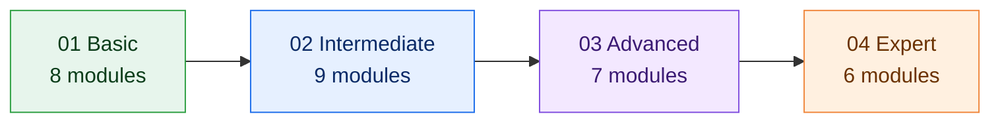

<div align="center">

# Digital Marketing and SEO
### From Basic to Expert

A learning curriculum that does not invent numbers, does not sell tricks, and checks every tactical claim against official documentation.

[](LICENSE)
[](LICENSE)
[](#)
[](#learning-path)
[](skills/)

[**Bahasa Indonesia**](README.md) &nbsp;|&nbsp; [**Start learning**](en/01-basic/01-apa-itu-digital-marketing.md) &nbsp;|&nbsp; [**Install the skill**](skills/README.md) &nbsp;|&nbsp; [**Verified claims**](en/references/klaim-ai-search-terverifikasi.md) &nbsp;|&nbsp; [**Free vs Pro**](PRO.en.md)

</div>

---

## Why this repo exists

Much SEO material contains statistics with no source, invented case studies, and outdated tactics. This repo follows the opposite rules.

| Rule | What it means in the material |
|---|---|
| **No invented numbers** | No example statistics or percentage predictions. No data, write N/A. |
| **Claims are labeled** | Verified against official sources, or marked "author's claim". |
| **Google data is separate from tool estimates** | Your Search Console and analytics are data. Volume and DR from other tools are estimates. |
| **Measure, do not claim** | Every exercise ends in a number from a real site. |
| **One firm recommendation** | Analysis ends with a decision backed by numbers, not a neutral list of options. |
| **Dated** | Documentation checks are dated, because Google keeps changing. |

---

## Learning path



Do not skip a level before meeting the completion criteria of the previous one. Each level ends with a study plan and a final project. File names are kept the same as the Indonesian originals so both languages map one to one.

### 01 Basic &nbsp;<sub>about 4 weeks</sub>
Foundations: how search engines work, the funnel, and free tools.

1. [What is digital marketing](en/01-basic/01-apa-itu-digital-marketing.md)
2. [Funnel and customer journey](en/01-basic/02-funnel-dan-customer-journey.md)
3. [How search engines work](en/01-basic/03-cara-kerja-search-engine.md)
4. [Basic SEO terms](en/01-basic/04-istilah-seo-dasar.md)
5. [Basic keyword research](en/01-basic/05-riset-keyword-dasar.md)
6. [Basic on-page SEO](en/01-basic/06-on-page-seo-dasar.md)
7. [Free tools: GSC, GA4, PageSpeed](en/01-basic/07-tools-gratis-gsc-ga4-pagespeed.md)
8. [30-day study plan](en/01-basic/08-rencana-belajar-30-hari.md)

### 02 Intermediate &nbsp;<sub>about 6 weeks</sub>
Building a system: clusters, structure, technical, content, local, links.

1. [Keyword clusters and cannibalization](en/02-intermediate/01-keyword-cluster-dan-kanibalisasi.md)
2. [Site structure and internal linking](en/02-intermediate/02-struktur-situs-dan-internal-linking.md)
3. [Essential technical SEO](en/02-intermediate/03-technical-seo-esensial.md)
4. [Content strategy and helpful content](en/02-intermediate/04-content-strategy-dan-helpful-content.md)
5. [Local SEO](en/02-intermediate/05-local-seo.md)
6. [Basic link building](en/02-intermediate/06-link-building-dasar.md)
7. [Advanced analytics: GSC and GA4](en/02-intermediate/07-analitik-gsc-ga4-lanjutan.md)
8. [Paid ads and SEO integration](en/02-intermediate/08-iklan-berbayar-dan-integrasi-seo.md)
9. [Intermediate study plan](en/02-intermediate/09-rencana-belajar-intermediate.md)

### 03 Advanced &nbsp;<sub>about 8 weeks</sub>
Diagnosis and risk: entity, trust, audit, indexing, spam.

1. [Entity SEO and brand](en/03-advanced/01-entity-seo-dan-brand.md)
2. [E-E-A-T and trust](en/03-advanced/02-eeat-dan-trust.md)
3. [Page audit](en/03-advanced/03-audit-halaman.md)
4. [Diagnosing pages that are not indexed](en/03-advanced/04-diagnosis-halaman-tidak-terindeks.md)
5. [Spam policy and risk management](en/03-advanced/05-spam-policy-dan-risiko.md)
6. [Healthy programmatic SEO](en/03-advanced/06-programmatic-seo-yang-sehat.md)
7. [Advanced study plan](en/03-advanced/07-rencana-belajar-advanced.md)

### 04 Expert &nbsp;<sub>about 12 weeks</sub>
Strategy and scale: AI Search, topical authority, decisions, automation.

1. [AI Search, AEO, and GEO](en/04-expert/01-ai-search-aio-geo.md)
2. [Topical authority](en/04-expert/02-topical-authority.md)
3. [Google Discover and images](en/04-expert/03-google-discover-dan-gambar.md)
4. [Strategy and decision making](en/04-expert/04-strategi-dan-pengambilan-keputusan.md)
5. [Automation and measurement](en/04-expert/05-otomasi-dan-pengukuran.md)
6. [Expert study plan](en/04-expert/06-rencana-belajar-expert.md)

---

## Tools

| Folder | Contents |
|---|---|
| [`en/templates/`](en/templates) | Keyword and intent map (CSV), page audit template, decision report |
| [`scripts/`](scripts) | `cluster_queries.py` (group queries, `--lang id/en/both`) and `check_urls.py` (HTTP status, redirects, noindex). Python 3, no dependencies |
| [`en/references/`](en/references) | Official sources, glossary, verified claims list |
| [`skills/`](skills) | Ready-to-use skills for AI agents |

Script examples:

```bash
python scripts/cluster_queries.py queries.csv --column query --lang en
python scripts/check_urls.py urls.txt
```

## Skill for AI agents

The folder [`skills/seo-playbook`](skills/seo-playbook/SKILL.md) is the English version of a short SEO procedure in `SKILL.md` format. It works with Claude Code, Hermes Agent, and similar agents. The Indonesian version is [`skills/seo-playbook-id`](skills/seo-playbook-id/SKILL.md).

```bash
git clone https://github.com/denburhan/digital-marketing-seo-roadmap.git
cp -r digital-marketing-seo-roadmap/skills/seo-playbook ~/.claude/skills/
```

---

## Free and Pro

This repo is the free, open version. The core curriculum, the skills, and the basic templates and scripts stay free here. A paid Pro version is being planned and is **not available yet**, with no price or release date. See [`PRO.en.md`](PRO.en.md) for the boundary between the two.

## Built by

<table>
<tr>
<td width="50%" valign="top">

### Burhan Efendi
Web developer and SEO from Nganjuk, East Java, Indonesia. Builds WordPress sites and Next.js apps, fixes their SEO, then automates repetitive work with AI. Serves local and international clients.

**[burhanefendi.my.id](https://www.burhanefendi.my.id)**

The site covers WordPress and SEO, Next.js full stack, AI and automation, and a [list of projects you can open directly](https://www.burhanefendi.my.id/portfolio/).

</td>
<td width="50%" valign="top">

### DigiMarket
A directory of selected Indonesian apps and websites. Find the product you need, or list your own for free.

**[digimarket.co.id](https://digimarket.co.id)**

At the time of writing (20 November 2026), its homepage shows "92+ Produk Terdaftar" (92+ listed products). That number was read from the site, not independently audited.

</td>
</tr>
</table>

**Need help applying this to your site?** Visit [burhanefendi.my.id](https://www.burhanefendi.my.id) to see services and get in touch.

---

## Contributing

Found an outdated or wrong claim? Open an issue with a link to the official source and the date you checked. Pull requests are welcome under the same rules as the content: no invented numbers, no fictional case studies, labeled claims. See [`CONTRIBUTING.md`](CONTRIBUTING.md).

## Ethics

- Do not touch ad accounts or production sites you do not own without permission.
- Do not use the scripts for aggressive crawling.
- Do not put credentials, tokens, or client data in the repo.

## License

Text (`.md` files): [CC BY 4.0](https://creativecommons.org/licenses/by/4.0/). Code (`scripts/`): MIT. Details in [`LICENSE`](LICENSE).

<div align="center"><sub>Google documentation changes. Re-check claims against the <a href="en/references/sumber-resmi.md">official sources</a> before basing decisions on them.</sub></div>
