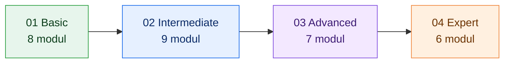

<div align="center">

# Digital Marketing dan SEO
### Dari Basic sampai Expert, berbahasa Indonesia

Kurikulum belajar yang tidak mengarang angka, tidak menjual trik, dan setiap klaim taktiknya dicek ke dokumentasi resmi.

[](LICENSE)
[](LICENSE)
[](#)
[](#peta-belajar)
[](skills/)

[**Mulai belajar**](01-basic/01-apa-itu-digital-marketing.md) &nbsp;|&nbsp; [**Pasang skill**](skills/README.md) &nbsp;|&nbsp; [**Klaim terverifikasi**](references/klaim-ai-search-terverifikasi.md) &nbsp;|&nbsp; [**Portfolio**](#dibuat-oleh)

</div>

---

## Kenapa repo ini ada

Banyak materi SEO memuat statistik tanpa sumber, studi kasus karangan, dan taktik yang sudah usang. Repo ini dibuat dengan aturan sebaliknya.

| Aturan | Artinya di materi |
|---|---|
| **Tanpa angka karangan** | Tidak ada statistik contoh atau prediksi persen. Data tidak ada, ditulis N/A. |
| **Klaim dilabeli** | Terverifikasi ke sumber resmi, atau ditandai "klaim penulis". |
| **Data Google dipisah dari estimasi tool** | Search Console dan analitik milikmu adalah data. Volume dan DR dari tool lain adalah estimasi. |
| **Ukur, jangan klaim** | Semua latihan berujung pada angka dari situs nyata. |
| **Satu rekomendasi tegas** | Analisis ditutup keputusan beralasan angka, bukan daftar opsi netral. |
| **Bertanggal** | Pemeriksaan dokumentasi dicatat tanggalnya, karena Google terus berubah. |

---

## Peta belajar



Jangan lompat level sebelum kriteria lulus level sebelumnya terpenuhi. Tiap level ditutup rencana belajar dan proyek akhir.

### 01 Basic &nbsp;<sub>sekitar 4 minggu</sub>
Fondasi: cara kerja mesin pencari, funnel, dan alat gratis.

1. [Apa itu digital marketing](01-basic/01-apa-itu-digital-marketing.md)
2. [Funnel dan customer journey](01-basic/02-funnel-dan-customer-journey.md)
3. [Cara kerja search engine](01-basic/03-cara-kerja-search-engine.md)
4. [Istilah SEO dasar](01-basic/04-istilah-seo-dasar.md)
5. [Riset keyword dasar](01-basic/05-riset-keyword-dasar.md)
6. [On-page SEO dasar](01-basic/06-on-page-seo-dasar.md)
7. [Tools gratis: GSC, GA4, PageSpeed](01-basic/07-tools-gratis-gsc-ga4-pagespeed.md)
8. [Rencana belajar 30 hari](01-basic/08-rencana-belajar-30-hari.md)

### 02 Intermediate &nbsp;<sub>sekitar 6 minggu</sub>
Membangun sistem: cluster, struktur, teknis, konten, lokal, tautan.

1. [Keyword cluster dan kanibalisasi](02-intermediate/01-keyword-cluster-dan-kanibalisasi.md)
2. [Struktur situs dan internal linking](02-intermediate/02-struktur-situs-dan-internal-linking.md)
3. [Technical SEO esensial](02-intermediate/03-technical-seo-esensial.md)
4. [Content strategy dan helpful content](02-intermediate/04-content-strategy-dan-helpful-content.md)
5. [Local SEO](02-intermediate/05-local-seo.md)
6. [Link building dasar](02-intermediate/06-link-building-dasar.md)
7. [Analitik GSC dan GA4 lanjutan](02-intermediate/07-analitik-gsc-ga4-lanjutan.md)
8. [Iklan berbayar dan integrasi SEO](02-intermediate/08-iklan-berbayar-dan-integrasi-seo.md)
9. [Rencana belajar intermediate](02-intermediate/09-rencana-belajar-intermediate.md)

### 03 Advanced &nbsp;<sub>sekitar 8 minggu</sub>
Diagnosis dan risiko: entity, kepercayaan, audit, indeks, spam.

1. [Entity SEO dan brand](03-advanced/01-entity-seo-dan-brand.md)
2. [E-E-A-T dan trust](03-advanced/02-eeat-dan-trust.md)
3. [Audit halaman](03-advanced/03-audit-halaman.md)
4. [Diagnosis halaman tidak terindeks](03-advanced/04-diagnosis-halaman-tidak-terindeks.md)
5. [Kebijakan spam dan manajemen risiko](03-advanced/05-spam-policy-dan-risiko.md)
6. [Programmatic SEO yang sehat](03-advanced/06-programmatic-seo-yang-sehat.md)
7. [Rencana belajar advanced](03-advanced/07-rencana-belajar-advanced.md)

### 04 Expert &nbsp;<sub>sekitar 12 minggu</sub>
Strategi dan skala: AI Search, topical authority, keputusan, otomasi.

1. [AI Search, AEO, dan GEO](04-expert/01-ai-search-aio-geo.md)
2. [Topical authority](04-expert/02-topical-authority.md)
3. [Google Discover dan gambar](04-expert/03-google-discover-dan-gambar.md)
4. [Strategi dan pengambilan keputusan](04-expert/04-strategi-dan-pengambilan-keputusan.md)
5. [Otomasi dan pengukuran](04-expert/05-otomasi-dan-pengukuran.md)
6. [Rencana belajar expert](04-expert/06-rencana-belajar-expert.md)

---

## Perkakas

| Folder | Isi |
|---|---|
| [`templates/`](templates) | Keyword and intent map (CSV), template audit halaman, laporan keputusan |
| [`scripts/`](scripts) | `cluster_queries.py` (kelompokkan query) dan `check_urls.py` (status HTTP, redirect, noindex). Python 3, tanpa dependensi |
| [`references/`](references) | Sumber resmi, glosarium, daftar klaim terverifikasi |
| [`skills/`](skills) | Skill siap pakai untuk agen AI |

Contoh pakai skrip:

```bash
python scripts/cluster_queries.py queries.csv --column query
python scripts/check_urls.py urls.txt
```

## Skill untuk agen AI

Folder [`skills/seo-playbook-id`](skills/seo-playbook-id/SKILL.md) berisi ringkasan prosedur kerja SEO dalam format `SKILL.md`. Cocok untuk Claude Code, Hermes Agent, dan agen sejenis.

```bash
git clone https://github.com/denburhan/digital-marketing-seo-roadmap.git
cp -r digital-marketing-seo-roadmap/skills/seo-playbook-id ~/.claude/skills/
```

Langkah untuk agen lain ada di [`skills/README.md`](skills/README.md).

---

## Dibuat oleh

<table>
<tr>
<td width="50%" valign="top">

### Burhan Efendi
Web developer dan SEO dari Nganjuk, Jawa Timur. Membangun situs WordPress dan aplikasi Next.js, membereskan SEO-nya, lalu mengotomasi pekerjaan berulang dengan AI. Melayani klien lokal dan mancanegara.

**[burhanefendi.my.id](https://www.burhanefendi.my.id)**

Isi situs: layanan WordPress dan SEO, Next.js full stack, AI dan otomasi, serta [daftar proyek yang bisa dibuka langsung](https://www.burhanefendi.my.id/portfolio/).

</td>
<td width="50%" valign="top">

### DigiMarket
Direktori aplikasi dan website pilihan Indonesia. Cari produk yang kamu butuhkan, atau daftarkan produkmu sendiri secara gratis.

**[digimarket.co.id](https://digimarket.co.id)**

Saat README ini ditulis (20 November 2026), halaman depannya menampilkan "92+ Produk Terdaftar". Angka itu dibaca dari situs, bukan hasil audit independen.

</td>
</tr>
</table>

**Butuh bantuan menerapkan materi ini di situsmu?** Kunjungi [burhanefendi.my.id](https://www.burhanefendi.my.id) untuk melihat layanan dan menghubungi langsung.

---

## Cara berkontribusi

Temukan klaim yang usang atau salah? Buka issue dengan tautan ke sumber resmi dan tanggal pemeriksaanmu. Pull request diterima dengan syarat sama seperti isi repo: tidak ada angka karangan, tidak ada studi kasus fiktif, klaim dilabeli.

## Etika

- Jangan menyentuh akun iklan atau situs produksi milik orang lain tanpa izin.
- Jangan memakai skrip untuk crawling agresif.
- Jangan memasukkan kredensial, token, atau data klien ke repo.

## Lisensi

Teks (file `.md`): [CC BY 4.0](https://creativecommons.org/licenses/by/4.0/). Kode (`scripts/`): MIT. Detail di [`LICENSE`](LICENSE).

<div align="center"><sub>Dokumentasi Google berubah. Cek ulang klaim ke <a href="references/sumber-resmi.md">sumber resmi</a> sebelum jadi dasar keputusan.</sub></div>
